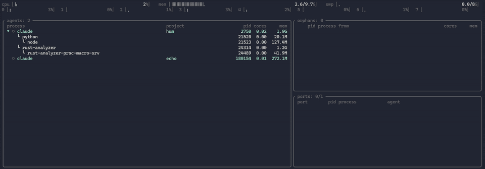

# hum

[](https://github.com/danczw/hum/actions/workflows/ci.yml)

A small terminal monitor for machines running coding agents. Built with [ratatui](https://ratatui.rs) and [sysinfo](https://crates.io/crates/sysinfo). Linux only.



- CPU, memory and swap
- Agents (claude, codex, aider, gemini, ...) with their process trees, marked `●` while busy and `○` while idle
- Listening TCP ports of agents and orphans, tagged with their owner. A `*` after the port (`:3000*`) marks a bind to a non-loopback address such as `0.0.0.0`; `a` shows every port
- Orphans: processes an agent started that outlived their parent. Claude Code marks its processes, so its orphans show even when they predate hum; for other agents hum catches them only while it runs

## Install

Releases ship static binaries for x86_64, i686, aarch64, armv7, armv6, riscv64, ppc64le and loongarch64.

```sh
curl -fsSL https://github.com/danczw/hum/releases/latest/download/install.sh | sh
```

The script installs to `~/.local/bin` and checks the archive against `SHA256SUMS`. `HUM_INSTALL_DIR` changes the directory, `HUM_VERSION=0.2.0` picks a release.

Other ways:

- Homebrew on Linux (x86_64, aarch64): `brew install danczw/tap/hum`
- Packages from the [latest release](https://github.com/danczw/hum/releases/latest): `.deb`, `.rpm`, `.apk` (unsigned, install with `apk add --allow-untrusted`) and Arch `.pkg.tar.zst`
- Tarballs `hum-<target>.tar.gz` from the same page
- From source: `cargo install --git https://github.com/danczw/hum --locked`. Release versions come from git tags, so a source build reports `hum 0.0.0-dev`

Every release file has a build provenance attestation: `gh attestation verify <file> -R danczw/hum`.

## Usage

```sh
hum [--interval <secs>] [--agent <name>]...
```

- `--interval <secs>`: tick length in seconds, 0.2 to 3600, default 1, fractions allowed (`0.5`). Ports refresh every 5 ticks.
- `--agent <name>`: also treat processes named `<name>` as agents, including scripts run by node, bun, deno or python. Repeatable.
- `-h`, `--help`: print usage. `-V`, `--version`: print the version.

Invalid input prints a one-line error and exits with code 2.

Keys: `j`/`k` or arrows move a cursor, `Tab` switches section, `Enter` expands or collapses an agent tree, `e`/`c` expand or collapse all, `1` shows a bar per CPU core, `a` shows all ports, `Esc` hides the cursor, `q` quits, `?` lists all keys.

## License

Apache-2.0, see [LICENSE](LICENSE).
